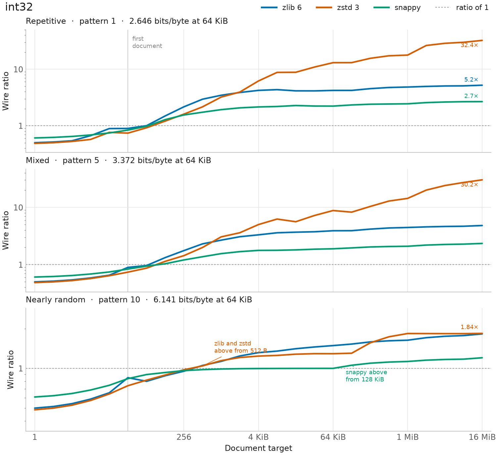
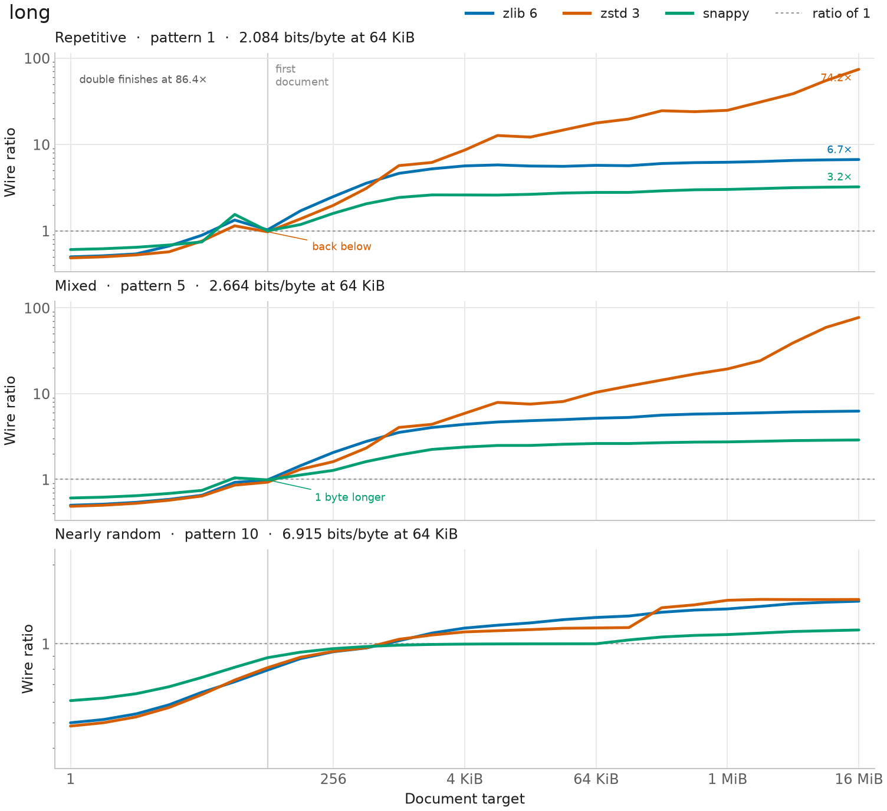
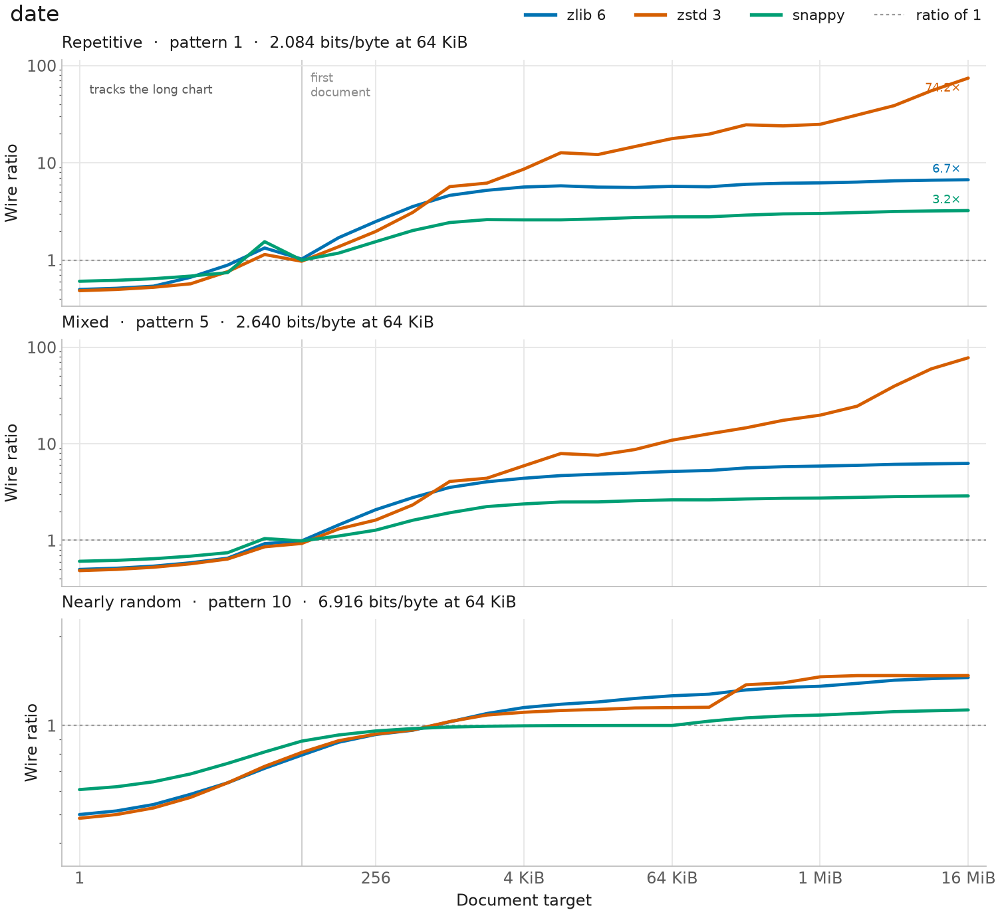
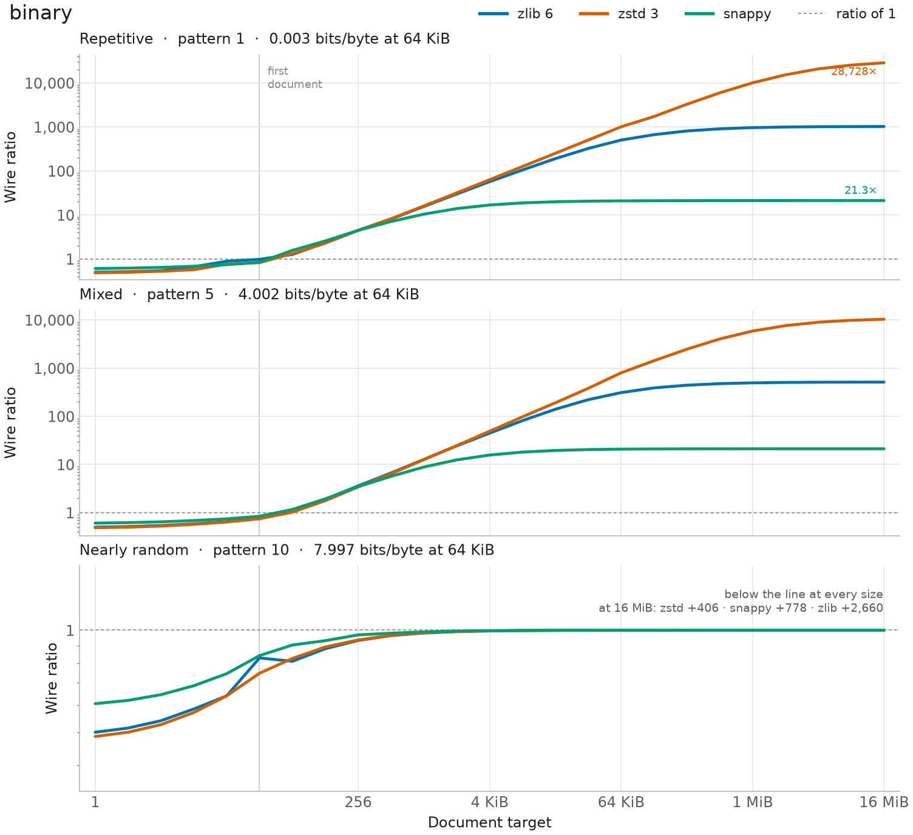

# Compressor analysis

This note is about network compression on an OP_MSG: the compressor a driver applies to a command before the bytes go on the wire. WiredTiger block compression is a different problem and is left out.

The ratio is the original message length divided by the framed `OP_COMPRESSED` length. Higher is tighter. A ratio of 1 means the framed message is the same size as the original. Below 1, compression made the message larger, and the drivers still send that larger message. The `none` row is an uncompressed OP_MSG, so it sits at 1. It is not the protocol noop compressor. Wrapping an unchanged body in the noop compressor would add the 9-byte details and make the message 9 bytes longer. That compressor was not measured.

The pictures are each carrier along document size, then all seven on one scale, then the manifold of every pattern, then the zstd level curve. [`src/compressor-charts.py`](src/compressor-charts.py) draws them from [`compressor-analysis.json`](compressor-analysis.json). The probe is [`src/compressor-probe`](src/compressor-probe).

## Summary

Repetitive BSON shrinks, and zstd shrinks it harder than zlib or snappy. On a 16 MiB string of zeros, zstd at level 3 reaches 28,728×, zlib 1,026×, and snappy 21×. A 16 MiB array of zero doubles still reaches 86.4× with zstd. An array of zero int32s does not, because the keys `"0"`, `"1"`, and so on are still in the document: zstd gets to 32.4×, zlib to 5.2×, snappy to 2.7×.

A zero long is the same eight zero bytes as a zero double, with type byte 0x12 instead of 0x01. zstd finishes that 16 MiB array at 74.2×. A date filled with the same bytes, type byte 0x09, finishes at 74.2× as well. zlib stays at 6.7× and snappy at 3.2× on all three. A timestamp does not follow the date. On a zero array zstd finishes it at 86.3×, with the double.

Random bytes do not shrink. A 16 MiB cryptographic binary is longer after framing for every compressor and every level in this grid. At the levels on the length charts, zstd adds 406 bytes, snappy 778, and zlib 2,660. A random printable string measures about 6.55 bits per byte. It looks like text. zlib and zstd get it down to about 1.21×. Snappy is still 777 bytes longer at 16 MiB.

The saving does not start at the first byte. Under a few dozen bytes the 25-byte frame costs more than the compressor gives back. The Node driver and the Rust driver have no small-message cutoff, so that larger frame is what goes out.

zstd level 3 is the level these drivers send when zstd is left unset, and it is the level the server uses when it compresses a reply. It is a strong default, and it is not the top of the curve. On a 64 KiB array of zero int32s, level 1 is tighter than level 3, level 13 falls to 7.7×, and levels 19–21 reach 36.7×. Those other levels are a Rust-only request. On the 16 MiB version of that array the order changes, and level 3 beats level 1.

## How to read the charts

Each carrier chart has three panels. The top is repetitive (pattern 1), the middle is mixed (pattern 5), and the bottom is nearly random (pattern 10). The horizontal axis is the target document size, on a log scale, from 1 byte to the largest legal BSON document, 16 MiB. The vertical axis is the wire ratio, also on a log scale. Each panel has its own vertical scale, so a 20× curve and a 20,000× curve can both be read.

Blue is zlib at level 6. Level −1 matches it on every paired cell, and −1 is the library default. Orange is zstd at level 3, the level these drivers send when zstd is left unset, and the level the server uses on a reply. Green is snappy. Snappy has no level. The dashed line is a ratio of 1. Above it, the framed message is smaller. Below it, the frame made the message larger. The pale vertical line is the first target that holds a real BSON document. To the left of that line the buffer is raw bytes.

The length charts draw those three defaults. The [level chart](#zstd-levels) draws every other measured zstd level in purple. Purple is a level the Rust driver can set in code. The connection string has no zstd level.

The bits/byte in each panel title are measured on that panel's 64 KiB document. The number is the pattern: which generator filled the bytes, from a run of zeros up to a cryptographic draw. Bits per byte are the entropy of that buffer. Where a panel carries a label, that label is the figure named in the paragraph under the chart.

The [manifold](#the-manifold) draws those same three compressors across every pattern. The length charts are its slices at patterns 1, 5, and 10. The vertical axis there is the pattern, not bits per byte.

## What was measured

The body is an OP_MSG body: 4 flag bytes, a kind byte of 0, and a BSON command `{ping: 1, p: <payload>}`. `ping` is a compressible command. The original wire size is the 16-byte header plus that body. The framed size is the 16-byte header, 9 bytes of `OP_COMPRESSED` details (original opcode, uncompressed size, compressor id), and the compressed body. This is the compressor output plus that 25-byte frame. It is not a socket round trip.

A target below a legal document is a raw buffer. An array stops before the next element, plus both terminators, would pass the target, and the row records the real document size. The first documents are int32 at 32 bytes (document 30), double, long, and date at 64 (document 56), decimal128 at 64 (document 61), and string and binary at 32 (document 32). A value of 2^24 does not fit: 16,777,216 is already the whole document.

Carriers are int32, double, long, date, decimal128, string, and binary. Null and bool are omitted. Timestamp was measured against the long and the date, and it is not one of the charts. Each carrier is its own surface. The [combined chart](#all-seven-carriers) puts them on one scale, and the [manifold](#the-manifold) is every pattern.

| Pattern | Generator |
| --- | --- |
| 1 | Constant zero |
| 2 | Period 4 |
| 3 | Byte counter, 0 through 255 |
| 4 | Stride 17 across the byte values |
| 5 | Low nibble |
| 6 | A short repeated phrase, or a small integer pattern |
| 7 | Half pattern, half xorshift |
| 8 | xorshift in a reduced range |
| 9 | xorshift across the type |
| 10 | CSPRNG. Strings are mapped into 95 printable bytes. Decimal128 is 16 random bytes, not a validated Decimal128 |

On a string or a binary that table is the byte generator. On a number, pattern 3 is the element index and pattern 4 is that index masked to a byte. A long and a date keep the high four bytes at zero through pattern 9. Pattern 10 fills all eight bytes from the CSPRNG. A timestamp is two uint32 fields, and on patterns 1–9 the same integer is written into both.

Patterns 1–9 are seeded, so the same pattern at the same size comes back as the same buffer. Pattern 10 is a fresh draw for every point. Two slices are two draws, which is why int32 pattern 10 at zlib 6 is 1.6329× on the length curve and 1.6332× on the `oneMiB` slice. The bits stay in a narrow band.

The probe calls the same snap, flate2, and zstd entry points the Rust driver uses. Library versions, and the driver version the level options were read from, are in the probe header. The mongodb crate is not linked. flate2 here is miniz_oxide, so the zlib bytes need not match Node or the server's libz.

With no arguments the probe writes `/tmp/compressor-grid.json` and `/tmp/compressor-digest.txt`. Two arguments are those two paths. It leaves the published grid where it is. Pattern 10 is a fresh draw on every run. [`src/compressor-charts.py`](src/compressor-charts.py) redraws the pictures from the JSON.

The Rust driver can name a zstd level. The others checked here cannot. The [compression spec](https://github.com/mongodb/specifications/blob/master/source/compression/OP_COMPRESSED.md) defines one level, `zlibCompressionLevel`, from −1 to 9. It calls −1 the library default, 0 no compression, 1 the fastest, and 9 the best compression. Snappy has no level. zstd was added later, and the spec still has no zstd level. Rust mongodb 3.10.1 exposes `Compressor::Zstd { level }` anyway: any value `zstd::compression_level_range()` returns, or `None` for level 3. The URI still only carries the zlib level. The [level chart](#zstd-levels) draws the Rust-only levels in purple, and the table under it lists what Node, PyMongo, and the Java driver can set.

Wire compressor ids are noop 0, snappy 1, zlib 2, zstd 3. The length curves use zlib 6, zstd 3, and snappy, at patterns 1, 5, and 10. The manifold uses those same three compressors on the other seven patterns. zstd levels 10–22 are on the 64 KiB sweep, and levels 19 and 22 are also on the 16 MiB sample for int32 and binary. They are not on the length curves or the manifold. The full cross of every level, every pattern, and every size was not run.

| Slice | What it is |
| --- | --- |
| `length` | Powers of two from 2^0 through 2^23, plus 16,777,216. Seven carriers. Patterns 1, 5, 10. |
| `level64` | 65,536 bytes. Seven carriers. Patterns 1–10. zlib −1 and 0–9, zstd −1 and 1–22, snappy. |
| `oneMiB` | 1,048,576 bytes. Seven carriers. Patterns 1–10. zlib −1 and 0–9, zstd 1, 3, 9, snappy. |
| `levelMax` | 16,777,216 bytes. int32 and binary only. Patterns 1 and 10. The level sample, including zstd 19 and 22. |
| `surface` | The same sizes as `length`. Seven carriers. Patterns 2, 3, 4, 6, 7, 8, and 9. zlib 6, zstd 3, and snappy. |
| `compare` | 65,536 and 16,777,216. long, date, and timestamp. Patterns 1, 5, 9, and 10. zlib 6, zstd 3, and snappy. |

## int32

The labels on the right of the top panel are the 16 MiB finish. The bottom panel marks where zlib and zstd go above the line, and where snappy does.

An int32 array never becomes a run of zeros. Even pattern 1 carries the keys, so the top panel tops out in the tens rather than the thousands. zstd pulls away from zlib once the document is past a few hundred bytes and finishes at 32.4×, against 5.2× for zlib and 2.7× for snappy. The middle panel is the same shape with a lower ceiling: 30.2× for zstd at 16 MiB.

The bottom panel is a fresh cryptographic draw in each integer, and it still shrinks. The keys and the 4-byte layout keep the 64 KiB document near 6.14 bits/byte rather than 8, and zstd finishes at 1.84×. Snappy is the late one. It is still below the line at 64 KiB (14 bytes longer, ratio 0.999786) and above it from 128 KiB. zlib and zstd are still below the line at 256 bytes and above it from 512.

The orange line is not smooth. zstd at level 3 gains, flattens, and gains again as the array grows. That is the same compressor refusing to be a straight function of size. The level chart later shows it refusing to be a straight function of the level either.

## double

The top panel marks the notch, where zstd drops back below the line on the first document, and labels the 16 MiB finish. The middle panel marks snappy's one-byte notch.

Zero doubles have more repeated bytes than zero int32s, and the ceiling shows it. zstd finishes the top panel at 86.4×, zlib at 6.7×, snappy at 3.2×.

Look at the pale line in the top panel. That is the first real document, 56 bytes inside a 64-byte target. zstd is already above the line on the 32-byte raw buffer (ratio 1.142857) and drops back below it on that first document (0.974684). From 128 bytes on it stays above. The dip is the change from a raw buffer to a document, not a change in the compressor. Snappy does a smaller version of the same notch on the middle panel: above the line on the 32-byte raw buffer (1.043478), one byte longer on the first document (0.987179), then above the line from 128 bytes.

On nearly random doubles, zlib and zstd are still below the line at 512 bytes and above it from 1 KiB, finishing near 1.45× and 1.47×. Snappy is still below the line at 64 KiB and above it from 128 KiB. It is 1.087× at 1 MiB and 1.128× on the max document. On the repetitive panel, snappy's last target below the line is 16 bytes. zstd's is 64, because of that notch at the first document.

## long

The labels on the right of the top panel are the 16 MiB finish. The notch is the same shape as on the double chart. The note in the corner is the zero double, which this array does not reach.

A zero long is eight zero bytes, the same value bytes as a zero double. The type byte is what changed. zlib finishes the top panel at 6.7× and snappy at 3.2×, the same as the double. zstd does not. It finishes at 74.2×, against 86.4× on the zero double. At 64 KiB the two zstd ratios still agree, both 17.7×. At 1 MiB they are 25.2× on the double and 24.9× on the long. The gap is open at 4 MiB, 48.6× against 38.7×.

The notch is the same shape as the double, and the same ratios. On the middle panel snappy is one byte longer on the first document, then above the line from 128 bytes. That panel finishes at 77.3× for zstd, a little above the double's 75.7×. zlib is 6.3× and snappy is 2.9×.

On nearly random longs the crossings match the double. zlib and zstd are still below the line at 512 bytes and above it from 1 KiB, finishing near 1.45× and 1.47×. Snappy is still below the line at 64 KiB and above it from 128 KiB.

## date

The labels are the 16 MiB finish. The note says what the picture is: this chart tracks the long chart, including the notch.

A date uses the same int64 ladder as the long. Only the type byte changes, 0x09 instead of 0x12. On a zero array the finishes match, and so does the notch.

The mixed pattern is where zstd separates them. At 64 KiB, zstd is 10.9× on the date and 10.4× on the long. At 16 MiB the finishes are 77.6× and 77.3×. zlib and snappy stay within a few thousandths on that pattern, 6.2612× against 6.2587× and 2.8829× against 2.8828×. Nearly random bytes match as well. zstd finishes at 1.4741× against the long's 1.4746×. The crossing table has the same cells for the date as for the long.

A timestamp looked like the same chart. It tracks the date for zlib and snappy on a zero array, and for all three compressors once the eight bytes are random. It does not track the date for zstd on a large zero array, or once both of its fields are filled.

A timestamp is two uint32 fields, increment then seconds. On a zero array those fields are zero, so the value bytes match a zero date and the type byte is 0x11. At 64 KiB, zstd is 17.7× on the timestamp, the date, the long, and the double. At 16 MiB, zstd finishes the timestamp at 86.3×, with the zero double, and the date at 74.2×, with the long. zlib is 6.7× and snappy is 3.2× on all four. zstd is the compressor that notices the type byte, and the difference shows up once the array is several megabytes.

Patterns 1 through 9 write the same integer into both fields, so the payload is denser than a date of the same pattern. At pattern 9 on the 16 MiB document the timestamp measures 6.646 bits/byte and the long 4.969. zstd is 1.48× on the timestamp and 2.22× on the long. zlib is 2.21× against 2.38×, and snappy is 1.43× against 1.55×. On the mixed pattern the timestamp is already a little denser at 16 MiB, 3.361 bits/byte against 2.987. Snappy finishes looser, 2.69× against 2.88×, and zstd finishes at 78.3× against the long's 77.3×. Pattern 10 is eight random bytes in both layouts. On that draw the three carriers match within 0.001 at 64 KiB and at 16 MiB. Snappy is still below the line at 64 KiB, 14 bytes longer, ratio 0.999786, on all three.

The `compare` slice is that measurement: long, date, and timestamp, at 64 KiB and 16 MiB, patterns 1, 5, 9, and 10. The date is the chart.

## decimal128

The top panel labels the 16 MiB finish, and marks 1.55× where snappy is briefly the tightest. The bottom panel carries the 64 KiB ratios.

Until the bytes are actually random, this is the most compressible number in the set. The value lives in the low bytes and the high bytes stay zero, so a zero decimal128 is mostly a run of zeros with a little structure. The 64 KiB document measures 1.457 bits/byte. On pattern 1, zstd finishes at 60.3×, zlib at 9.1×, and snappy at 4.8×. All three are still below the line at 16 bytes and above it from 32. At 32 bytes snappy is the tightest of the three, 1.55×, and from 128 bytes it falls behind.

Pattern 10 fills all 16 bytes from the CSPRNG. Those bytes are not a validated Decimal128. The 64 KiB document is the noisiest number in the grid, 7.476 bits/byte. At that size zstd is 1.06× and zlib is 1.12×. Snappy stays below the line through 64 KiB and goes above it from 128 KiB, same as pattern 10 on the other numbers. At 16 MiB the ratios are 1.25× for zstd, 1.23× for zlib, and 1.08× for snappy.

The zlib curve on pattern 1 is not perfectly smooth. It is 8.6879× at 64 KiB, 8.6753× at 1 MiB, and 9.0757× at the max document. The 1 MiB point is a hair looser than the 64 KiB point. The data did not get harder. The compressor found a slightly worse block split.

## string

The labels on the right are the 16 MiB ratios. The bottom panel marks that snappy stays below the line.

This chart is a different instrument. A string of zero bytes measures 0.003 bits/byte. zstd keeps finding a smaller encoding as the run gets longer: 1,009× at 64 KiB, 10,083× at 1 MiB, 28,728× at 16 MiB. zlib climbs and then flattens: 504×, 966×, 1,026×. Snappy is already 20.9× at 64 KiB and only inches up to 21.3× at 16 MiB. More of the same zero does not buy snappy another factor of a thousand.

The middle panel is a repeated phrase, 4.002 bits/byte, and the shape repeats at a lower ceiling. zstd finishes at 10,376×. Snappy is still about 21×. The entropy number says this phrase is "more random" than an int32 array at 3.37 bits/byte. The ratios disagree: that int32 array finishes at 30.2× with zstd, and this phrase finishes at 10,376×. Bits per byte are the right axis label and a poor universal predictor. The carrier decides.

The bottom panel is the one to be careful with. Pattern 10 maps random bytes into 95 printable characters, so it measures 6.548 bits/byte on this draw and looks like text. zlib and zstd are still below the line at 256 bytes and above it from 512, and they are essentially done by 1 MiB, at about 1.21×. From 1 MiB to 16 MiB, zlib moves from 1.206653× to 1.206659×. Snappy stays below the line. At 16 MiB the framed snappy message is 777 bytes longer than the original.

## binary

The 28,728× on the top panel is the same finish as the zero string. The note on the bottom panel is the byte count for the three lines drawn there. Those lines stay below the line at every sampled size.

The top two panels match the string. A run of zero bytes is a run of zero bytes, whether the BSON type is string or binary. At 1 MiB, zlib is 966.4488× on both and zstd is 10,082.6635× on both. At the max document zlib is 1,025.4408× on the binary and 1,025.5035× on the string. The keys in an int32 array are what break that match. The same zlib level on a zero int32 array is 5.2×.

The bottom panel does not match the string, because pattern 10 here is raw CSPRNG, 7.997 bits/byte, with no alphabet to hide in. Every compressor stays below the dashed line at every sampled size, including 16 MiB. Raising the level does not fix it. At 64 KiB, every zstd level from −1 through 22 is the same 19 bytes longer (ratio 0.999710). At 16 MiB, snappy is 778 bytes longer. zstd is 406 bytes longer at every sampled level except level 22, which is one byte less. zlib is 2,660 bytes longer at every sampled level except level 1, which is 15,514 bytes longer, ratio 0.999076. There is no level in this grid at which a cryptographic binary should be wrapped.

## The manifold

Each sheet is one compressor across every pattern and every sampled size. The length charts are the slices at patterns 1, 5, and 10. The vertical axis is the pattern, not bits per byte.

The missing patterns are not a straight slope between the panels above. On the string, zstd at 1 MiB is 10,083× at pattern 1, 2,503× at patterns 3 and 4, 5,924× at pattern 5, and 1.999× at pattern 7. Patterns 3 and 4 both use every byte value, which is why they share a ratio, and pattern 7 is where half the bytes become noise. The cliff at pattern 7 is on the sheet at 64 KiB and at 16 MiB. The valley at patterns 3 and 4 is deep at 64 KiB and at 1 MiB, and shallow by 16 MiB. The length charts show patterns 1, 5, and 10 and skip both.

On a number, pattern 3 is the element index, so a long document is a long counter. On the 16 MiB double, zstd is 85.9× at pattern 2, 7.4× at pattern 3, and 75.7× at pattern 5. The middle panel of the double chart sits next to the top panel and never shows that hole.

## All seven carriers

The bottom row is labelled where the shared scale hides the result: snappy below the line on the printable string, and every drawn line below it on the cryptographic binary.

The zero string and the zero binary leave the top row. Among the numbers, zstd's zero double is the highest finish, 86.4×. The long and the date sit together at 74.2×, short of the double. The decimal128 follows, then the int32 array, held down by its keys. zlib and snappy do not make that split. On the zero double, the zero long, and the zero date they finish at 6.7× and 3.2×. Snappy's green line barely leaves the bottom of the string and binary panels. On a pure run it has a ceiling near 21×, and zstd does not.

Read the bottom row and the order changes in the way the entropy would have suggested. The numeric arrays cannot be pure noise, so they finish above the line: int32 highest, then the double, the long, and the date close together, then decimal128. The printable string just clears the line for zlib and zstd, and snappy stays just below it. The cryptographic binary never clears it. The shared scale makes that last panel look empty. It is empty on purpose. A ratio of 0.999976 and a ratio of 1 are the same pixel, which is why the byte counts are the number to keep.

A single bits/byte figure does not place a payload on one of these curves. String pattern 5 is 4.00 bits/byte and zstd's ratio at 1 MiB is 5,924×. int32 pattern 5 is 3.37 bits/byte and the ratio is 14.3×. The string is the higher entropy estimate and the vastly easier payload, because one of them is a repeated phrase and the other is keys plus integers.

At 1 MiB, zlib level 6 beats zstd level 3 on a handful of mid-entropy rows: double pattern 8 (2.4919× against 2.2528×), long pattern 8 (2.6210× against 2.4344×), date pattern 8 (2.6211× against 2.4406×), and decimal128 patterns 7, 8, and 9 (3.4225× against 3.2770×, 3.8855× against 3.6416×, 2.0305× against 1.9601×). Everywhere else in that slice, zstd 3 is tighter, usually by a lot. Snappy is the loosest of the three on the repetitive rows and the first to give up as the bytes get noisier. From pattern 8 up, snappy is below the line on both string and binary.

### Where the framed message stops being larger

This is the largest sampled target still below the line, the last size at which the framed message is longer than the original. On the double charts the line is crossed twice, so the number here is the later one. The dips are the notches at the first document, described above. Bits are the length-slice document at 64 KiB.

| Carrier | Pattern | Bits at 64 KiB | zlib 6 | zstd 3 | snappy |
| --- | --- | --- | --- | --- | --- |
| int32 | 1 | 2.646 | 32 | 64 | 64 |
| int32 | 5 | 3.372 | 64 | 64 | 64 |
| int32 | 10 | 6.141 | 256 | 256 | 65,536 |
| double | 1 | 2.084 | 16 | 64 | 16 |
| double | 5 | 2.979 | 64 | 64 | 64 |
| double | 10 | 6.919 | 512 | 512 | 65,536 |
| long | 1 | 2.084 | 16 | 64 | 16 |
| long | 5 | 2.664 | 64 | 64 | 64 |
| long | 10 | 6.915 | 512 | 512 | 65,536 |
| date | 1 | 2.084 | 16 | 64 | 16 |
| date | 5 | 2.640 | 64 | 64 | 64 |
| date | 10 | 6.916 | 512 | 512 | 65,536 |
| decimal128 | 1 | 1.457 | 16 | 16 | 16 |
| decimal128 | 5 | 1.868 | 32 | 32 | 16 |
| decimal128 | 10 | 7.476 | 1,024 | 1,024 | 65,536 |
| string | 1 | 0.003 | 32 | 32 | 32 |
| string | 5 | 4.002 | 32 | 32 | 32 |
| string | 10 | 6.548 | 256 | 256 | 16,777,216 |
| binary | 1 | 0.003 | 32 | 32 | 32 |
| binary | 5 | 4.002 | 32 | 32 | 32 |
| binary | 10 | 7.997 | 16,777,216 | 16,777,216 | 16,777,216 |

### Ratio at 16 MiB

The same length curve, at the max document. A ratio below 1 is six decimals so it does not round to 1.0000. The zlib cells for a string at pattern 10 are six decimals for the same reason.

| Carrier | Pattern | zlib 6 | zstd 3 | snappy |
| --- | --- | --- | --- | --- |
| int32 | 1 | 5.2085 | 32.3538 | 2.6696 |
| int32 | 5 | 4.8207 | 30.2315 | 2.3444 |
| int32 | 10 | 1.8220 | 1.8385 | 1.2027 |
| double | 1 | 6.6922 | 86.4311 | 3.2307 |
| double | 5 | 6.2604 | 75.6518 | 3.6323 |
| double | 10 | 1.4522 | 1.4746 | 1.1282 |
| long | 1 | 6.6936 | 74.1804 | 3.2307 |
| long | 5 | 6.2587 | 77.2849 | 2.8828 |
| long | 10 | 1.4520 | 1.4746 | 1.1283 |
| date | 1 | 6.6922 | 74.1689 | 3.2307 |
| date | 5 | 6.2612 | 77.5955 | 2.8829 |
| date | 10 | 1.4521 | 1.4741 | 1.1280 |
| decimal128 | 1 | 9.0757 | 60.3339 | 4.7988 |
| decimal128 | 5 | 8.5267 | 57.1260 | 4.2628 |
| decimal128 | 10 | 1.2317 | 1.2508 | 1.0796 |
| string | 1 | 1,025.5035 | 28,728.1455 | 21.3179 |
| string | 5 | 513.9927 | 10,375.5331 | 21.2144 |
| string | 10 | 1.206659 | 1.2106 | 0.999954 |
| binary | 1 | 1,025.4408 | 28,728.1455 | 21.3179 |
| binary | 5 | 514.0085 | 10,369.1205 | 21.2144 |
| binary | 10 | 0.999841 | 0.999976 | 0.999954 |

## zstd levels

The orange point is labelled level 3, the level these drivers send when zstd is left unset. Purple is every other measured level.

The left chart is one document, a 64 KiB array of zero int32s, run through every zstd level this library accepts from −1 to 22. The orange point is level 3, in a sag at 13.1×. That is the level these drivers send when zstd is left unset. The purple curve is the rest, and it is a Rust-only request. Level 1, to the left of the orange point, is 16.4×. The curve then bumps along, drops to 7.7× at level 13, jumps, and peaks at levels 19–21 at 36.7×. Level 22 is a hair looser, 36.6×. Level −1 is inside the legal range (measured here as −131072 through 22) and it is a fast level of its own, 7.4× on this document. It matched level 3 on 13 of the 74 paired cells in the grid, all of them string or binary, and it differed on the other 61. Every numeric pair differed.

The right chart is the same kind of array at 16 MiB, at the levels there was time to run. The dots are those levels. Nothing was measured between them. The sag has moved. Level 3 is now 32.4× and beats level 1 at 24.8×. Level 9, which is an easy number to reach for, is the loosest of the positive levels in the sample, 21.1×. Level 19 is the tightest, 44.6×, and level 22 is 44.4×. Level −1 is 15.6×. Snappy, with nothing to turn, is 2.7× on this document and 2.2× on the 64 KiB one. Even the worst zstd level in either chart beats snappy on this particular array. That is a statement about zero int32s, not about the cryptographic binary, where every zstd level loses.

zlib has its own small version of this. The spec calls level 9 the best compression. On the 16 MiB zero int32 array, level 3 is the tightest of the sampled zlib levels at 6.21×, and level 6, the default match, is 5.21×. Level 9 is 5.2075×, slightly looser than level 6. Level 0 is store. It is 2,660 bytes longer on that document, ratio 0.999841. Level −1 matches level 6 on all 669 paired cells. Blue on the length charts is that level 6. The other zlib levels are a URI option, from −1 to 9, so they are not drawn in purple.

Which levels a caller can actually set depends on the driver. This is not a universal feature.

| Compressor | Connection string | Rust code | Node, PyMongo, Java |
| --- | --- | --- | --- |
| snappy | No level | No level | No level |
| zlib | −1 to 9 | 0 to 9, or unset for the flate2 default | Node publishes 0 to 9, and 0 selects the default. PyMongo and Java take −1 to 9 |
| zstd | None | Any level in the library range, or unset for 3 | 3 only |

Rust's `validate()` rejects a zstd level outside `zstd::compression_level_range()`. The three compression features are off unless the crate is built with them. PyMongo calls `zstd.compress` with no level. The Java driver calls `Zstd.defaultCompressionLevel()`. Node hardcodes `ZSTD_COMPRESSION_LEVEL = 3`.

The reply does not follow the client level. The server has no compression level to set. `net.compression.compressors` only names which compressors it will offer. `session_workflow.cpp` keeps the compressor id from a compressed request and compresses the reply with that compressor's compiled-in default: `Z_DEFAULT_COMPRESSION` for zlib, and `ZSTD_CLEVEL_DEFAULT` for zstd, which is 3. A client that sends zstd at level 19 still reads a level-3 reply. Snappy has no level. An uncompressed request is answered uncompressed.

## What the drivers send

A compressed body that is larger than the original is still written.

mongosh 2.14.2, Node driver `OpCompressedRequest.toBin`, wraps a compressible command once a compressor has been agreed. The Rust driver `write_op_compressed_to` writes `OP_COMPRESSED` after compressing. The probe called the same snap, flate2, and zstd entry points, so the ratios above are the bytes those calls produce. A 1-byte raw buffer at zlib 6 is the small end of the same fact: the original wire message is 17 bytes, the framed message is 34, and the ratio is 0.5.

The log line "Compressed message would be larger than maximum allowed" is a different check. `MaxMessageSizeBytes` is `48 * 1000 * 1000`. `MessageCompressorManager::compressMessage` returns the original message when the worst-case compressed buffer, plus the 9-byte details and the 16-byte header, would exceed that. For zlib the bound first exceeds 48,000,000 at body length 47,985,319. The grid records that length as `guardTripsAtBody`. No body in this grid trips it. A legal document is at most 16 MiB. The short-message expansion is the frame.

On an incompressible input the compressor keeps the bytes and adds a frame, which is why the ratio sits just below 1 instead of falling apart. At 16 MiB of cryptographic binary, zstd at level 3 adds a 397-byte frame and the 9-byte details make 406 on the wire. zlib's stored-block framing is the 2,660 bytes. Snappy's is the 778.

flate2 level 0 is store, and that is what Rust sends for level 0. The Node driver sets a zlib level only when `zlibCompressionLevel` is truthy, and `compressCommand` passes `description.zlibCompressionLevel ?? 0`, so an omitted level and an explicit 0 both take the default on that driver. The level 0 row in the JSON is the store row. It is not the row this Node driver sends for 0. The Rust URI accepts `zlibCompressionLevel` −1 as the flate2 default, which matched level 6 here, and rejects values above 9 and negatives other than −1. A sweep of the client zlib level moves the request only.

The Node driver leaves `hello`, the legacy hello names, `saslStart`, `saslContinue`, `getnonce`, `authenticate`, `createUser`, `updateUser`, `copydbSaslStart`, `copydbgetnonce`, and `copydb` uncompressed. The grid uses `ping`. An uncompressed request gets an uncompressed reply.

Snappy has no level. This mongosh has no `snappy` module, so the Node driver on this machine does not offer it. The green lines are the library the Rust driver links when the feature is on.

`write_op_compressed_to` returns an error when the framed length exceeds the max message size. Before hello that cap is `48 * 1024 * 1024`, which is 50,331,648 bytes. After hello it is the size the server advertised, 48,000,000. The two caps differ by 2,331,648 bytes. The expansion in this grid is far inside both.

## Conclusion

Turn zstd on for ordinary documents, logs, and low-cardinality fields. That is where the wire saving is large, and where zlib and snappy, while useful, leave most of it behind. The int32 charts are the reminder that "ordinary" includes the keys. An array of integers compresses like an array of keys, not like a string of the values. A zero long and a zero date belong there too, at 74.2× rather than the double's 86.4×. A timestamp of zeros finishes with the double. The date section has that comparison.

Leave compression off when the payload is ciphertext, a compressed blob, or any other near-random binary. Every level in this grid still adds a frame, and within a legal document the ratio stays below 1. Printable random text is the awkward middle. zlib and zstd reach about 1.21×, and snappy costs bytes at every size.

Keep snappy in the negotiated list when the peer supports it and the payload is repetitive. It starts helping at slightly smaller sizes than zstd on some of the numeric rows, because its wrapper is slimmer, and it stops helping sooner as the bytes get noisier. It has no level to get wrong. It will not do for a cryptographic binary what it does for a run of zeros, and on a run of zeros it flattens near 21× while zstd keeps going. This mongosh build does not include the module. The Rust driver can, behind a feature that is off by default. The server's default list is `snappy,zstd,zlib`, and negotiation walks the client's list.

Leave zstd at level 3, the orange point, unless a measured payload says otherwise. On the 64 KiB zero int32 array the purple levels include a tighter level 1 and a tighter band at 19–21. On the same array at 16 MiB, level 3 beats level 1 and level 9 is a step backwards. A higher number is not a tighter message. Node, PyMongo, and the Java driver have no zstd level to change. Rust can change it in code, and the connection string still cannot. That setting is on the client. The server answers with the negotiated compressor at that compressor's own default, so a client level changes the request only. The zstd reply stays at 3.

The small-message penalty is real, and it is not the 48,000,000 guard. Below a few dozen bytes the frame dominates, the ratio drops below 1, and the driver sends the framed message anyway. The guard is a worst-case allocation check that a legal document never reaches.

## Appendix

Ratios below are wire ratios from the `oneMiB` slice, at 1,048,576 bytes. Pattern 10 in this slice is a different draw from pattern 10 on the length charts.

### zlib 6 at 1 MiB

| Pattern | int32 | double | long | date | decimal128 | string | binary |
| --- | --- | --- | --- | --- | --- | --- | --- |
| 1 | 4.8345 | 6.2239 | 6.2249 | 6.2238 | 8.6753 | 966.4488 | 966.4488 |
| 2 | 4.8153 | 6.2152 | 6.2161 | 6.2155 | 8.6613 | 960.2537 | 961.1338 |
| 3 | 3.6558 | 6.2043 | 4.8663 | 4.8663 | 6.8661 | 235.6398 | 235.7457 |
| 4 | 3.2887 | 5.1077 | 4.3029 | 4.3080 | 6.1380 | 235.6398 | 235.7457 |
| 5 | 4.4526 | 5.8676 | 5.8659 | 5.8703 | 8.4092 | 495.0883 | 495.3222 |
| 6 | 4.7531 | 6.1721 | 6.1712 | 6.1723 | 8.6119 | 398.4031 | 398.4031 |
| 7 | 2.8989 | 3.8048 | 3.8816 | 3.8822 | 3.4225 | 1.9892 | 1.9892 |
| 8 | 1.9460 | 2.4919 | 2.6210 | 2.6211 | 3.8855 | 1.4617 | 1.4617 |
| 9 | 1.6337 | 2.0516 | 2.2134 | 2.2134 | 2.0305 | 1.2005 | 1.2005 |
| 10 | 1.6332 | 1.3572 | 1.3572 | 1.3573 | 1.1775 | 1.2066 | 0.999824 |

String patterns 3 and 4 are the same ratio, and binary patterns 3 and 4 are the same ratio, because both generators use every byte value. On the length charts that is why the middle of a string chart falls off a cliff relative to a run of zeros, while an int32 chart only sags.

### zstd 3 at 1 MiB

Level 1 is tighter than level 3 on this slice for int32 patterns 1, 2, 5, 6, and 8 (37.8009× against 17.7719× at pattern 1), double patterns 1, 2, and 5, and decimal128 patterns 1, 2, 5, 6, and 8. Decimal128 pattern 4 is close: 14.6484× against 14.6386×. On long and date, level 1 is tighter at patterns 1, 2, 4, 5, 6, 7, and 8. On the zero string and the zero binary, level 3 is the tighter of the two.

| Pattern | int32 | double | long | date | decimal128 | string | binary |
| --- | --- | --- | --- | --- | --- | --- | --- |
| 1 | 17.7719 | 25.1981 | 24.8523 | 24.8582 | 40.9238 | 10,082.6635 | 10,082.6635 |
| 2 | 17.8175 | 24.7112 | 24.8859 | 25.2363 | 40.5864 | 6,393.8841 | 6,355.1333 |
| 3 | 4.6336 | 8.5914 | 6.5781 | 6.5783 | 10.0399 | 2,502.6181 | 2,496.6595 |
| 4 | 8.2141 | 15.9978 | 9.9068 | 9.9337 | 14.6386 | 2,502.6181 | 2,496.6595 |
| 5 | 14.3402 | 18.9086 | 19.4062 | 19.7669 | 31.1885 | 5,924.2768 | 5,890.9944 |
| 6 | 17.3983 | 23.0876 | 23.1442 | 23.3109 | 37.5287 | 5,698.8967 | 5,668.0919 |
| 7 | 3.9270 | 4.5692 | 5.3198 | 5.3215 | 3.2770 | 1.9990 | 1.9990 |
| 8 | 1.9672 | 2.2528 | 2.4344 | 2.4406 | 3.6416 | 1.5318 | 1.5318 |
| 9 | 1.8333 | 2.2926 | 2.2187 | 2.2153 | 1.9601 | 1.2036 | 1.2036 |
| 10 | 1.8354 | 1.4622 | 1.4622 | 1.4639 | 1.2316 | 1.2104 | 0.999957 |

At the max document the relationship on pattern 1 flips for the numeric carriers. Level 3 is tighter than level 1: 32.3538× against 24.8378× for int32, 86.4311× against 41.1268× for double, 74.1804× against 41.1352× for long, 74.1689× against 41.1340× for date, and 60.3339× against 56.2017× for decimal128. Level 9 is the loosest of those three on the numbers. On the zero string and the zero binary, levels 1 and 3 meet at 28,728.1455× and level 9 is one step tighter, 28,777.4220×.

### snappy at 1 MiB

| Pattern | int32 | double | long | date | decimal128 | string | binary |
| --- | --- | --- | --- | --- | --- | --- | --- |
| 1 | 2.4419 | 3.0146 | 3.0143 | 3.0145 | 4.5913 | 21.2952 | 21.2952 |
| 2 | 2.4290 | 3.0007 | 3.0087 | 3.0087 | 4.5798 | 21.2745 | 21.2740 |
| 3 | 1.7773 | 2.5011 | 2.1496 | 2.1496 | 3.1825 | 19.6897 | 19.6897 |
| 4 | 1.5595 | 2.2090 | 2.1025 | 2.1026 | 3.1281 | 19.6897 | 19.6897 |
| 5 | 2.0928 | 3.3966 | 2.7372 | 2.7378 | 4.0817 | 21.1919 | 21.1911 |
| 6 | 2.1951 | 3.3897 | 2.9198 | 2.9198 | 4.4511 | 21.1530 | 21.1530 |
| 7 | 1.5914 | 2.3303 | 2.1149 | 2.1156 | 2.0577 | 1.9096 | 1.9096 |
| 8 | 1.2915 | 1.5240 | 1.7675 | 1.7676 | 2.4969 | 0.999945 | 0.999943 |
| 9 | 1.1272 | 1.4527 | 1.4468 | 1.4468 | 1.5358 | 0.999945 | 0.999945 |
| 10 | 1.1268 | 1.0836 | 1.0840 | 1.0831 | 1.0492 | 0.999945 | 0.999945 |

### Bits per byte at 64 KiB

From the `level64` draw. Patterns 3 and 4 on a byte payload fill all 256 values, so they measure 8.000. String pattern 10 stays near 6.550 because it is printable. Binary pattern 10 is 7.998. Decimal128 stays lower than int32, double, string, and binary until pattern 10. Long and date measure lower than decimal128 at patterns 7 and 9.

| Pattern | int32 | double | long | date | decimal128 | string | binary |
| --- | --- | --- | --- | --- | --- | --- | --- |
| 1 | 2.646 | 2.084 | 2.084 | 2.084 | 1.457 | 0.003 | 0.003 |
| 2 | 3.077 | 2.638 | 2.440 | 2.440 | 1.716 | 2.002 | 2.002 |
| 3 | 4.493 | 3.862 | 3.513 | 3.506 | 2.429 | 8.000 | 8.000 |
| 4 | 3.785 | 3.440 | 2.963 | 2.963 | 2.060 | 8.000 | 8.000 |
| 5 | 3.372 | 2.979 | 2.664 | 2.640 | 1.868 | 4.002 | 4.002 |
| 6 | 3.555 | 2.850 | 2.838 | 2.838 | 2.004 | 2.968 | 2.968 |
| 7 | 4.094 | 4.127 | 3.215 | 3.216 | 3.392 | 6.369 | 6.369 |
| 8 | 5.280 | 6.492 | 4.199 | 4.175 | 2.945 | 5.171 | 5.171 |
| 9 | 6.146 | 5.488 | 4.967 | 4.968 | 5.095 | 6.571 | 6.571 |
| 10 | 6.137 | 6.913 | 6.915 | 6.912 | 7.476 | 6.550 | 7.998 |
